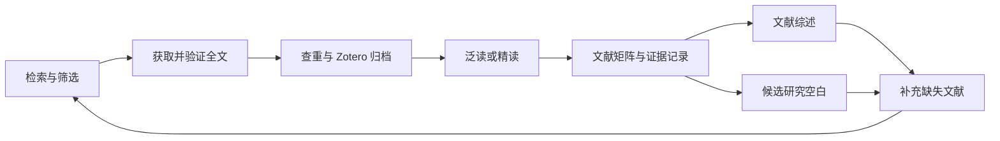

# AcadeMill-Econ

面向经济学与管理学研究的 AI 工作流：文献检索与阅读、选题、研究设计、数据与实证、论文写作和学术报告。保留原 Paper Assist 六模块规范与 Claude Code 入口，新增 Codex 技能、独立研究记录和 Zotero 文献协同。

这是技能与工具仓库，入口是项目根目录中的 AI 会话和中文请求，没有 Web 服务或 `main.py`。仓库不包含用户论文、研究数据、校园账号或 Zotero 密钥。

## 六个模块

| 模块 | 常用请求 | 项目技能 |
| --- | --- | --- |
| 文献阅读 | 泛读、批量泛读、精读、对比 | `paper-reader` |
| 选题辅助 | 研究空白、评估选题、趋势分析、复制拓展 | `topic-selection` |
| 研究设计 | 识别方案、设计参考、内生性诊断、稳健性清单 | `research-design` |
| 数据与实证 | 数据推荐、变量构造、描述统计、回归代码 | `data-empirical` |
| 论文写作 | 文献综述、引言、摘要、润色、审稿与回应 | `paper-writing` |
| 学术报告 | 幻灯、讲稿、答辩问答、海报 | `academic-presentation` |

原规范定义内容与模板，`.agents/skills/` 提供实际技能入口。当前工具和材料决定能完成哪些操作；生成代码不等于已运行实证，幻灯大纲不等于已导出 PPT。

## 文献检索与 Zotero



- 校园示例：Microsoft Edge → [浙大 WebVPN](https://webvpn.zju.edu.cn/) → 人工登录 → 电子资源导航 → 中文 CNKI / 英文 Web of Science。其他学校可指定自己的校园入口。
- 明确需要 Google Scholar 时才使用 Chrome，配置独立于校园检索浏览器。
- Zotero 导入先查重、复用父条目、补缺失附件；笔记作为 HTML 子笔记写入并读回。只有摘要时保留摘要级记录。
- 泛读与精读是两种阅读模式。对比、综述、空白使用矩阵与可定位的原文证据；个人库缺文献不代表领域存在空白。
- 新使用者先明确归档授权，可启用“新选定文献下载后默认归档并泛读”。纯检索不自动下载或写库；当次“仅下载、不写 Zotero、不阅读”优先。

详见 [文献协同指南](docs/LITERATURE_WORKFLOW.md) 和 [校园检索指南](docs/LITERATURE_SEARCH.md)。

## 开始使用

```bash
git clone https://github.com/cinderellameixner-spec/AcadeMill-Econ.git
cd AcadeMill-Econ
python -m venv .venv
```

激活虚拟环境后安装依赖：

```bash
python -m pip install -r requirements.txt
# 可选：Zotero Web API 归档
python -m pip install -r requirements-zotero.txt
# 可选：运行计量代码
python -m pip install -r requirements-empirical.txt
```

需要 Python 3.10+，PDF 提取器适用于文本型 PDF，暂不含 OCR。

**Codex：** 在根目录启动 CLI 或打开 IDE 项目，读取 `AGENTS.md` 与 `.agents/skills/`，先尝试本地阅读，再按需连接浏览器及 Zotero。配置步骤见 [CODEX_SETUP.md](CODEX_SETUP.md)。

**Claude Code：** 原 `CLAUDE.md`、`.claude/` 与 `paper-reading/CLAUDE.md` 保留兼容。旧说明引用的用户级技能、MCP 和机器路径仍须在使用者环境配置，不随克隆自动安装。新增协同可让 Claude 显式读取 `AGENTS.md` 与项目技能；Codex 不运行会修改 Claude 全局设置的 `tools/switch-browser.ps1`。

```text
读取 AGENTS.md，列出模块与当前工具，只做检查。
新建独立研究，名称是“数字化转型与就业”。
泛读 R001 的 inbox 中这篇论文，先生成笔记，不写 Zotero。
通过校园资源检索数字经济文献：中文 CNKI、英文 WoS，先展示候选。
启用文献协同：新选定文献下载后查重归档到指定 Zotero 合集并泛读。
用 R001 的指定文献生成初步综述，给出论断与原文证据对应表。
梳理候选研究空白，再补最近三年的直接研究与相反证据，最多 5 篇。
```

## 研究目录与恢复

每个独立研究使用 `research/R编号_名称/`，保存输入、成果、来源、决策及逐轮摘要。新聊天可说“继续 R001，先读项目状态与最近摘要”。研究材料与本机配置默认不提交。

```bash
python tools/research_project.py new "数字化转型与就业"
python tools/research_project.py list
python tools/research_project.py run R001 "进一步评估数据可得性"
```

详见 [研究记录指南](docs/RESEARCH_GUIDE.md) 与 [目录地图](docs/DIRECTORY_MAP.md)。

## 检查与能力边界

```bash
python -m pip install -r requirements-dev.txt
python -m unittest discover -s tests -v
python tools/check_public_package.py
```

测试使用临时材料和模拟客户端，不访问校园账户或写真实文献库。已验证范围、待验证部分和人工步骤见 [VALIDATION.md](docs/VALIDATION.md)。浏览器与 Zotero MCP 是外部能力，克隆不会安装或连接；只读连接不等于写权限。

原模块关系见 [paper_assist_workflow.md](paper_assist_workflow.md)。采用 [MIT License](LICENSE)；订阅文献与用户数据不随代码许可证重新分发。
